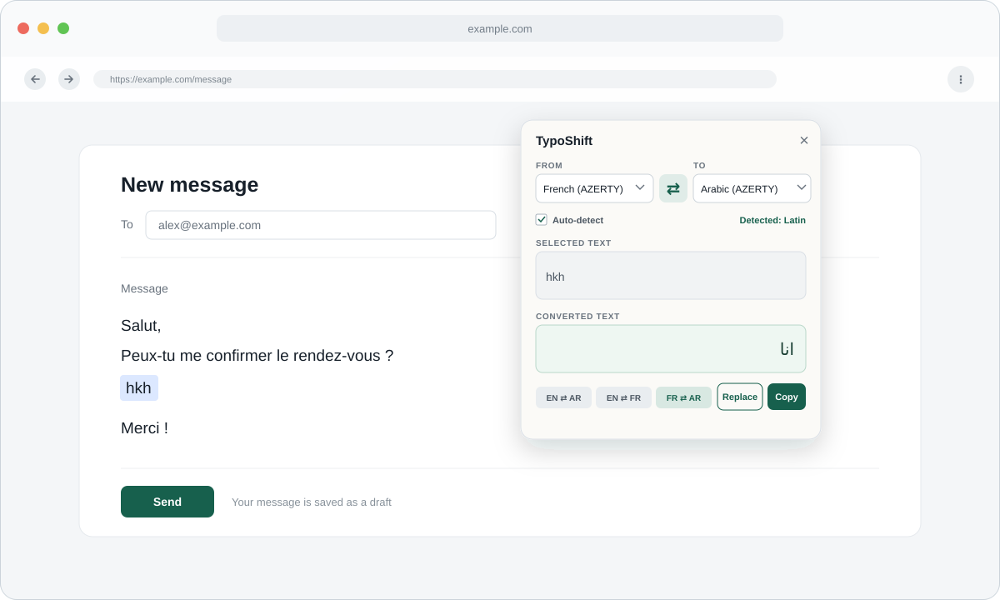

   # TypoShift

   TypoShift converts text typed with the wrong French, Arabic, or English keyboard layout.
   

   [](LICENSE)
   [](manifest.json)
   [](manifest.json)
   [](https://github.com/M003aad/TypoShift/actions/workflows/ci.yml)

   ## Table of Contents

   - [Overview / Architecture](#overview--architecture)
   - [Features](#features)
   - [Screenshots](#screenshots)
   - [Codebase Breakdown](#codebase-breakdown)
   - [Permissions](#permissions)
   - [Installation & Setup](#installation--setup)
   - [Usage](#usage)
   - [Contributing](#contributing)
   - [Security](#security)
   - [License](#license)

   ## Overview / Architecture

   TypoShift is a browser extension that reads selected text, detects whether it is written in Arabic or Latin script, and converts it by matching the physical keys across the supported layouts. The extension targets the browser environment directly and does not require a backend or package build step.

   The current implementation is built with:

   - JavaScript
   - Manifest V3
   - Chrome/Chromium extension APIs (`chrome.storage.local`, clipboard access, content scripts)
   - No bundler or framework

   The runtime structure is straightforward:

   - `content.js` handles selection detection, the floating trigger, popup interactions, copy, and direct replacement.
   - `converter.js` contains the conversion logic and script/direction detection rules.
   - `mappings.js` defines the English, French, and Arabic keyboard layouts by physical row position.
   - `styles.js` injects the UI styles into the popup’s Shadow DOM.
   - `manifest.json` registers the content script and extension permissions.

   ## Features

   - Converts text between English (QWERTY), French (AZERTY), and Arabic (AZERTY) layouts.
   - Detects whether the selected text is Arabic or Latin and suggests the correct conversion direction automatically.
   - Uses French-only symbols such as `é`, `ç`, `à`, and `°` to prefer the French layout when Latin text is ambiguous.
   - Supports quick conversion pairs like `EN ⇄ AR`, `EN ⇄ FR`, and `FR ⇄ AR`.
   - Allows manual source/target selection and swap actions inside the popup UI.
   - Works with selected text in regular text fields, textareas, and contenteditable elements.
   - Excludes password fields from inspection and never reads them.
   - Saves the last-used source/target settings with `chrome.storage.local`.
   - Uses a closed Shadow DOM so the extension UI remains visually isolated from page styling.

   ## Screenshots

   

   ## Codebase Breakdown

   ```text
   TypoShift/
   ├── .github/
   │   ├── ISSUE_TEMPLATE/
   │   │   ├── bug_report.md
   │   │   └── feature_request.md
   │   ├── PULL_REQUEST_TEMPLATE.md
   │   └── workflows/
   │       ├── ci.yml
   │       └── release.yml
   ├── assets/
   │   ├── 16.16.png
   │   ├── 32.32.png
   │   ├── 48.48.png
   │   └── 128.128.png
   ├── test/
   │   └── converter.test.js
   ├── content.js
   ├── converter.js
   ├── mappings.js
   ├── styles.js
   ├── .editorconfig
   ├── .gitattributes
   ├── .gitignore
   ├── .prettierrc
   ├── CHANGELOG.md
   ├── CODE_OF_CONDUCT.md
   ├── CONTRIBUTING.md
   ├── CITATION.cff
   ├── LICENSE
   ├── README.md
   ├── SECURITY.md
   ├── SUPPORT.md
   ├── manifest.json
   └── SUMMARY.md
   ```

   | File / directory | Purpose |
   | --- | --- |
   | `assets/` | Extension icons used by the browser and floating trigger. |
   | `test/converter.test.js` | Verifies conversion logic, layout alignment, duplicate keys, and script detection. |
   | `content.js` | Handles selection capture, popup UI, replacement flow, storage, and clipboard actions. |
   | `converter.js` | Converts text using key-position mapping and detects the script/direction. |
   | `mappings.js` | Defines the keyboard layout matrices for English, French, and Arabic. |
   | `styles.js` | Injects the popup styling into the Shadow DOM. |
   | `manifest.json` | Declares the extension metadata, content script, permissions, and icons. |
   | `LICENSE` | AGPL-3.0 license for the project. |
   | `README.md` | User-facing overview and installation details. |
   | `.github/` | Issue templates, pull request template, and CI/release automation. |

   ## Permissions

   | Permission | Why it is needed |
   | --- | --- |
   | `storage` | Saves the last source/target layout choice in the browser. |
   | `clipboardWrite` | Enables the Copy button to place converted text on the clipboard. |
   | Content script on `<all_urls>` | Monitors page text selection and injects the TypoShift UI on any page. |
   | Web-accessible `assets/48.48.png` | Allows the floating extension icon to display on webpages. |

   ## Installation & Setup

   1. Clone the repository:

      ```bash
      git clone https://github.com/M003aad/TypoShift.git
      cd TypoShift
      ```

   2. Open the project in Chrome or Edge.
   3. Navigate to `chrome://extensions/` (or `edge://extensions/`).
   4. Enable Developer mode.
   5. Click **Load unpacked** and select the repository folder.
   6. Refresh any tabs where you want to test selection conversion.

   No package manager or build pipeline is required because this extension is plain JavaScript and loads directly as an unpacked browser extension.

   ## Usage

   1. Visit any page and select text in a standard input, textarea, or editable region.
   2. A TypoShift trigger appears next to the selection.
   3. The trigger shows the detected conversion direction, such as `LT→AR` or `AR→LT`.
   4. In the popup, review the source/target layout selection and the converted result.
   5. Use **Copy** to copy the converted text, or **Replace** to replace the original selection in place where supported.
   6. Adjust the quick pair or swap orientation as needed; the last chosen setting is remembered locally.

   ## Contributing

   We welcome improvements and bug reports. See [CONTRIBUTING.md](CONTRIBUTING.md) for local development notes, issue guidance, and pull request expectations.

   ## Security

   Please report vulnerabilities through the private reporting process described in [SECURITY.md](SECURITY.md). For non-security issues, use the GitHub issue tracker.

   ## License

   This project is distributed under the AGPL-3.0 license. See [LICENSE](LICENSE) for the full legal text. Maintainer: M003aad.

